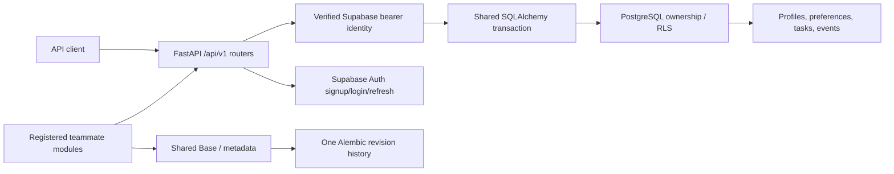

# Backend architecture

This is the Sprint 1 feature-based modular monolith. User and Scheduler own their routers, services, schemas and models; Core owns shared infrastructure. Business tables remain `public.profiles`, `user_preferences`, `tasks`, and `events`; Supabase owns `auth.users`. The initial migration and approved core model definitions are preserved.

## Responsibilities and file locations

| File/package | Responsibility |
|---|---|
| `app/main.py` | Application factory, lifespan cleanup, health endpoints, API registration, security headers, optional CORS |
| `app/core/config.py` | Central environment settings and endpoint/credential guards |
| `app/core/security.py` | Signature/issuer/audience/time/subject/role verification using trusted JWKS |
| `app/core/dependencies.py` | Shared bearer dependency and function-scoped `SessionDep` |
| `app/core/base.py` / `app/core/models.py` | Single shared Base and eager built-in model discovery |
| `app/modules/user/models.py` | Profile and UserPreferences; external Auth FK in separate metadata |
| `app/modules/scheduler/models.py` | Task and Event, using the same shared Base |
| `app/core/database.py` | Shared runtime engine, role validation, transaction-local verified identity |
| `app/core/registry.py` | Module model/router discovery and managed public-table allowlist |
| `app/modules/user/` | Authentication, profiles and preferences routers/services/contracts |
| `app/modules/scheduler/` | Task and Event routers/services/contracts and pagination |
| `app/core/schemas.py` | Shared Contract/Patch, validation helpers and error responses |
| `app/core/errors.py` / `app/core/openapi.py` | Error contract and usable API examples |
| `alembic/` | One application migration environment and history |
| `tests/` | Shared disposable database/identity fixtures and API/security tests |

User's `router.py` includes authentication then profiles. Scheduler's `router.py` includes tasks then events. `main.py` registers User then Scheduler under the existing `/api/v1` prefix, followed by configured additional modules. Module aggregators add no extra URL prefix. Built-in User/Scheduler modules do not need `BACKEND_MODULES` entries.

Scheduler models import `Profile` for their existing relationship annotations; User's Task/Event relationships remain string references. `app/core/models.py` loads both modules before shared metadata discovery. No second Base or migration history is introduced.

## Authentication and transactions

Public registration/login use the configured Supabase publishable/anon key. The backend forwards passwords only to the trusted Auth origin and never persists them. Confirmation-required signup returns no session and creates no profile. `/auth/verify-otp` accepts email and a six-digit secret token string and calls the Supabase `/auth/v1/verify` endpoint used by `verifyOtp`, with the server-controlled type `signup`. Supabase generates and validates the code; the backend never stores it. The hosted Confirm signup email template uses `{{ .Token }}`. Successful code verification or verified login creates a missing profile and retains validated username/full_name metadata; existing profile changes are never overwritten. If a requested optional username is taken, onboarding leaves it null so login remains usable; profile PATCH can choose another name and still returns 409 on conflicts.

Refresh verifies the returned JWT and subject and returns rotated tokens without requiring a database transaction. This prevents database downtime from discarding a newly rotated refresh token. Signup/login and application profile writes cannot be one distributed transaction; if database onboarding is unavailable after Auth succeeds, retry login when the database recovers. Do not create or delete an Auth account to compensate.

Registration checks for an existing confirmed or pending email with a bounded, read-only Auth Admin request before signup; explicit duplicate rejection returns 409. `SUPABASE_SERVICE_ROLE_KEY` is isolated to this lookup. It is never used for public Auth operations, JWT verification, or normal database CRUD, and it is excluded from settings repr. Public signup/login/verify/resend use `SUPABASE_PUBLIC_KEY` or the optional `SUPABASE_ANON_KEY` alias. Missing/unavailable private lookup credentials fail registration closed. Supabase remains authoritative for concurrent account uniqueness. Resend delegates to `/auth/v1/resend` with type signup and returns a generic accepted response without a session or database transaction. Both initial and resent codes use the same Confirm signup template.

Protected routes use `SessionDep`. A token is verified before connection acquisition. A dedicated runtime LOGIN must inherit authenticated, lack superuser/BYPASSRLS/administrative memberships, and have no ownership path to any registered application table. Per transaction, only verified subject/authenticated claims enter parameterized transaction-local settings. UTC and row_security are set locally too. Owner filters supplement PostgreSQL RLS; user_id never comes from the body.

For local manual Swagger testing, `APP_ENV=development` together with the explicit `ALLOW_ADMIN_DATABASE_RUNTIME=true` option permits the existing administrative database connection without provisioning a separate runtime role. The default remains false, and production settings reject this option. Table presence and RLS-enabled checks, JWT verification, verified ownership filters, transaction-local identity, and pool rollback remain in place. **Administrative `postgres` access bypasses RLS:** setting `row_security=on` does not remove `BYPASSRLS`, and JWT claims do not switch the SQL login role. Isolation for these requests therefore relies on application ownership filters. This mode cannot verify database RLS isolation and must not be used in production. Existing RLS policies remain meaningful for restricted database roles and Supabase Data API requests using those roles.

Function-scoped dependency teardown commits or rolls back before the HTTP response is sent. Commit failures therefore cannot produce successful responses. Pool return rolls back residual transactions. Pool-size-one tests verify identity cleanup after success, failure, and connection reuse. Runtime credentials remain trusted backend secrets: SQL access with those credentials must never be given to end users.

The profile insert trigger creates exactly one preferences row. Existing triggers, column grants, CHECK constraints and policies remain active. IDs, owners, timestamps, task status and event source/status are read-only. No signup trigger is added to auth.users.

## Configuration and lifecycle

`Settings` reads `.env` without overriding injected environment values. Runtime uses only DATABASE_URL; Alembic/role provisioning use only MIGRATION_DATABASE_URL. Actual secrets, environments, local cluster files and signing keys are ignored. Remote database URLs require verify-full TLS; remote Auth requires HTTPS. Loopback HTTP Auth is permitted only in explicitly chosen development mode. Wildcard CORS is rejected; configure exact browser origins when necessary.

This workspace's ignored `.env` currently contains the Supabase runtime connection with `APP_ENV=development` and `ALLOW_ADMIN_DATABASE_RUNTIME=true`. Start the server with the standard documented uvicorn command. `.env.supabase` is not required. Restart the process after changing `.env`; existing process variables retain precedence. No password, token, key, or connection URL belongs in committed documentation.

No network/SQL connection is made merely to import models or build OpenAPI. Engines and Auth HTTP connections are reused, with bounded pools and timeouts. Owned resources close in application lifespan cleanup. Missing Auth configuration allows local health/docs/test development but protected APIs remain unavailable until configured.

JWT verification supports ES256/RS256 signing keys. HS256 is rejected; use asymmetric keys for local Supabase too. PyJWT 2.15.1+ supplies thread-safe JWKS caching, no redirects and a 30-second unknown-key refresh cooldown; the backend does not duplicate that cache. JWT NumericDate claims must be finite numbers (not booleans/strings), and the subject must be a non-nil UUID.

## Validation and performance

PATCH validates the merged record, not just submitted fields. Dates/instants remain finite; timestamps require offsets and normalize to UTC. Persisted strings reject whitespace-only required values and null characters. Collection limits are 1–100, default 50; offsets are 0–1,000,000. `has_more` uses limit+1 and avoids COUNT queries. List responses load no relationships, and query-count tests show no per-item queries. Existing owner/deadline and event owner/partial recurrence indexes support common filtering. Security role checks remain constant per transaction.

Weekly rules retain local dates/times, end-day offset and their own timezone. ISO weekday derives from first_date. Validation resolves first and bounded final endpoints and rejects DST gaps/folds or non-positive resolved intervals. It cannot certify every intervening/future timezone transition. Any later consumer interpreting an occurrence must resolve both endpoints with `resolve_unambiguous_local_time` and check positive duration. No recurrence expansion API, occurrence rows, exceptions or optimizer is implemented.

## Scope boundary

Teammates add module packages and use the shared registry, session, Auth and migration history. No energy/attention calculations, Decision Engine, optimization, rescheduling, frontend code or frontend integration are included.
