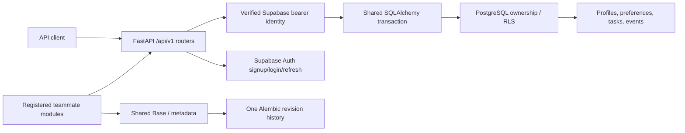

# Backend architecture

This is the shared Sprint 1 backend. Business tables remain `public.profiles`, `user_preferences`, `tasks`, and `events`; Supabase owns `auth.users`. The initial migration and approved core model definitions are preserved.

## Responsibilities and file locations

| File/package | Responsibility |
|---|---|
| `app/main.py` | Application factory, lifespan cleanup, health endpoints, API registration, security headers, optional CORS |
| `app/config.py` | Central environment settings and endpoint/credential guards |
| `app/auth.py` | Signature/issuer/audience/time/subject/role verification using trusted JWKS |
| `app/dependencies.py` | Shared bearer dependency and function-scoped `SessionDep` |
| `app/db/models.py` | Single shared Base and four approved core models; external Auth FK reference in separate metadata |
| `app/db/session.py` | Shared runtime engine, role validation, transaction-local verified identity |
| `app/db/registry.py` | Module model/router discovery and managed public-table allowlist |
| `app/routers/` | REST endpoints and typed request/response contracts |
| `app/services/` | Auth protocol, onboarding, preferences and owner-filtered persistence |
| `app/schemas.py` | Validation, immutable input fields, response models and pagination |
| `app/errors.py` / `app/openapi.py` | Error contract and usable API examples |
| `alembic/` | One application migration environment and history |
| `tests/` | Shared disposable database/identity fixtures and API/security tests |

## Authentication and transactions

Public registration/login use the configured Supabase publishable/anon key. The backend forwards passwords only to the trusted Auth origin and never persists them. Confirmation-required signup returns no session and creates no profile. Verified login creates a missing profile and retains validated username/full_name metadata; existing profile changes are never overwritten. If a requested optional username is taken, onboarding leaves it null so login remains usable; profile PATCH can choose another name and still returns 409 on conflicts.

Refresh verifies the returned JWT and subject and returns rotated tokens without requiring a database transaction. This prevents database downtime from discarding a newly rotated refresh token. Signup/login and application profile writes cannot be one distributed transaction; if database onboarding is unavailable after Auth succeeds, retry login when the database recovers. Do not create or delete an Auth account to compensate.

Protected routes use `SessionDep`. A token is verified before connection acquisition. A dedicated runtime LOGIN must inherit authenticated, lack superuser/BYPASSRLS/administrative memberships, and have no ownership path to any registered application table. Per transaction, only verified subject/authenticated claims enter parameterized transaction-local settings. UTC and row_security are set locally too. Owner filters supplement PostgreSQL RLS; user_id never comes from the body.

Function-scoped dependency teardown commits or rolls back before the HTTP response is sent. Commit failures therefore cannot produce successful responses. Pool return rolls back residual transactions. Pool-size-one tests verify identity cleanup after success, failure, and connection reuse. Runtime credentials remain trusted backend secrets: SQL access with those credentials must never be given to end users.

The profile insert trigger creates exactly one preferences row. Existing triggers, column grants, CHECK constraints and policies remain active. IDs, owners, timestamps, task status and event source/status are read-only. No signup trigger is added to auth.users.

## Configuration and lifecycle

`Settings` reads `.env` without overriding injected environment values. Runtime uses only DATABASE_URL; Alembic/role provisioning use only MIGRATION_DATABASE_URL. Actual secrets, environments, local cluster files and signing keys are ignored. Remote database URLs require verify-full TLS; remote Auth requires HTTPS. Loopback HTTP Auth is permitted only in explicitly chosen development mode. Wildcard CORS is rejected; configure exact browser origins when necessary.

No network/SQL connection is made merely to import models or build OpenAPI. Engines and Auth HTTP connections are reused, with bounded pools and timeouts. Owned resources close in application lifespan cleanup. Missing Auth configuration allows local health/docs/test development but protected APIs remain unavailable until configured.

JWT verification supports ES256/RS256 signing keys. HS256 is rejected; use asymmetric keys for local Supabase too. PyJWT 2.15.1+ supplies thread-safe JWKS caching, no redirects and a 30-second unknown-key refresh cooldown; the backend does not duplicate that cache. JWT NumericDate claims must be finite numbers (not booleans/strings), and the subject must be a non-nil UUID.

## Validation and performance

PATCH validates the merged record, not just submitted fields. Dates/instants remain finite; timestamps require offsets and normalize to UTC. Persisted strings reject whitespace-only required values and null characters. Collection limits are 1–100, default 50; offsets are 0–1,000,000. `has_more` uses limit+1 and avoids COUNT queries. List responses load no relationships, and query-count tests show no per-item queries. Existing owner/deadline and event owner/partial recurrence indexes support common filtering. Security role checks remain constant per transaction.

Weekly rules retain local dates/times, end-day offset and their own timezone. ISO weekday derives from first_date. Validation resolves first and bounded final endpoints and rejects DST gaps/folds or non-positive resolved intervals. It cannot certify every intervening/future timezone transition. Any later consumer interpreting an occurrence must resolve both endpoints with `resolve_unambiguous_local_time` and check positive duration. No recurrence expansion API, occurrence rows, exceptions or optimizer is implemented.

## Scope boundary

Teammates add module packages and use the shared registry, session, Auth and migration history. No energy/attention calculations, Decision Engine, optimization, rescheduling, frontend code or frontend integration are included.
