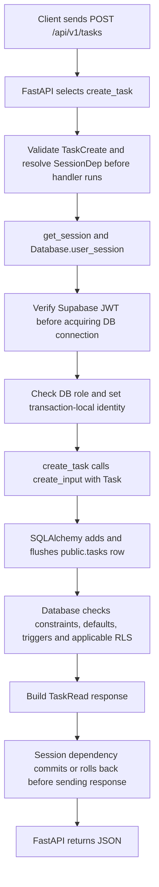
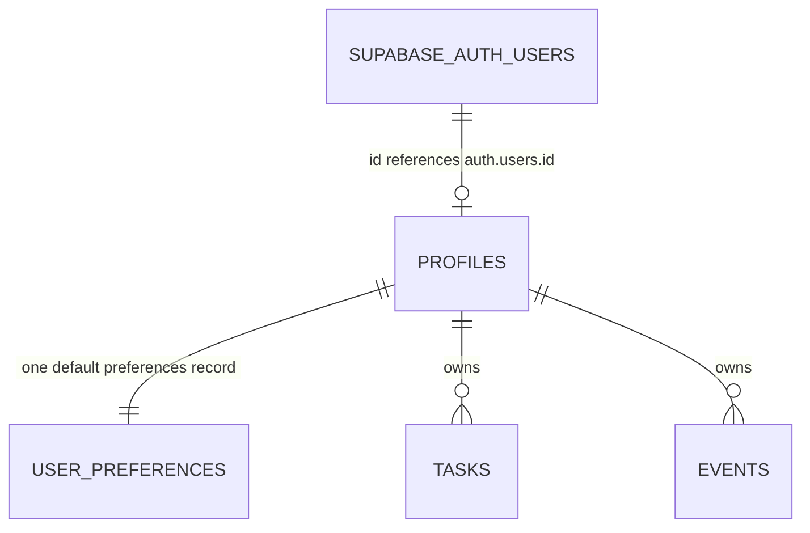

# DAYLI Backend Codebase Guide

This guide explains the FastAPI backend in `code/backend/`. Start with **Section 2: Where every endpoint lives** if you want to find the function behind a Swagger operation.

All file paths are relative to the repository root. For example, `code/backend/app/modules/scheduler/routers/tasks.py` means that file inside the backend, not a second copy elsewhere. The links open the actual source files.

This guide reflects the feature-based reorganization. User and Scheduler code now live together by module; function implementations, API behavior and migration history were preserved. No tests were run during this reorganization.

## 1. Project structure

### The folders you will use most

```text
graduation project/
├── docs/
│   ├── CODEBASE_GUIDE.md                 # This guide: code locations and request flow
│   └── manual-backend-testing-guide.md   # Manual PowerShell and Swagger instructions
└── code/
    └── backend/
        ├── app/
        │   ├── main.py                  # Builds FastAPI and registers both module routers
        │   ├── core/                    # Shared infrastructure, kept in one place
        │   │   ├── config.py            # Settings; still loads backend/.env
        │   │   ├── security.py          # JWT signature and identity verification
        │   │   ├── database.py          # Engine, role guards, transactions and identity
        │   │   ├── dependencies.py      # Shared authenticated SessionDep
        │   │   ├── base.py              # Single SQLAlchemy Base and owner_fk()
        │   │   ├── models.py            # Imports all built-in models for discovery
        │   │   ├── schemas.py           # Shared contracts, validation helpers and errors
        │   │   ├── registry.py          # Discovers configured additional modules
        │   │   ├── migration_scope.py   # Schema-qualified FK reflection
        │   │   ├── database_check.py    # Existing read-only database utility
        │   │   ├── errors.py            # Central HTTP error handling
        │   │   ├── openapi.py           # Existing API documentation customization
        │   │   └── timezones.py         # Timezone and DST validation
        │   └── modules/
        │       ├── user/                # User team works mainly here
        │       │   ├── router.py        # Includes authentication and profiles; no URL prefix
        │       │   ├── routers/
        │       │   │   ├── authentication.py  # Register, OTP, resend, login and refresh
        │       │   │   └── profiles.py  # Profile and preferences endpoints
        │       │   ├── services/
        │       │   │   ├── authentication.py  # Supabase Auth HTTP operations
        │       │   │   └── profiles.py  # Onboarding and preferences operations
        │       │   ├── schemas.py       # User request and response contracts
        │       │   └── models.py        # Profile, UserPreferences and external Auth FK
        │       └── scheduler/           # Scheduler team works mainly here
        │           ├── router.py        # Includes tasks and events; no URL prefix
        │           ├── routers/
        │           │   ├── tasks.py     # Task CRUD and filtering
        │           │   └── events.py    # Event CRUD and filtering
        │           ├── services/
        │           │   └── inputs.py    # Existing owner-filtered Task/Event operations
        │           ├── schemas.py       # Task/Event contracts and pagination
        │           └── models.py        # Task and Event
        ├── alembic/
        │   ├── env.py                   # Same shared environment; updated model imports
        │   ├── script.py.mako
        │   └── versions/
        │       └── 0001_sprint1_foundation.py  # Existing migration; unchanged
        ├── scripts/                     # Existing local/admin utilities
        ├── tests/                       # Existing tests; imports updated, not run
        ├── docs/                        # API, architecture, modules, migrations and email
        ├── review/                      # Historical audit and migration SQL copies
        ├── .env                         # Private local configuration; ignored
        ├── .env.example                 # Environment names and placeholders
        ├── .gitignore                   # Secret and generated-file exclusions
        ├── prod-ca-2021.crt              # Remote database CA certificate
        ├── alembic.ini                  # Shared migration configuration
        ├── pyproject.toml               # Python project and dependency requirements
        ├── requirements.lock            # Pinned dependencies
        ├── README.md                    # Setup and run instructions
        ├── CONTRIBUTING.md              # Team workflow
        ├── .venv/                       # Installed environment; do not edit
        └── .local/                      # Ignored local files and logs
```

The tree is deliberately selective. Other tests, audit/plan documents, package markers, and generated caches exist, but they are not regular feature-editing entry points. `.pytest_cache/` and `__pycache__/` are generated files, not application logic.

### Which files are essential?

| Category | Files/folders | When you use them |
|---|---|---|
| Running application | `app/main.py`, routers, services, schemas, dependencies, Auth and database foundation | Understand or change API behavior |
| Configuration | `.env`, `.env.example`, `app/core/config.py`, `.gitignore` | Configure your own environment and protect secrets |
| Dependencies | `pyproject.toml`, `requirements.lock`, `.venv/` | Install or intentionally update Python libraries |
| Database history | `alembic/`, `alembic.ini` | Add a reviewed physical database change |
| Utilities | `scripts/`, `app/core/database_check.py` | Specific setup/admin tasks; not normal request handlers |
| Documentation | Both `docs/` folders, backend README and CONTRIBUTING | Learn usage, API contracts, and team workflow |
| Review material | `review/`, older checklist/plan files | Understand past decisions; not live endpoint code |
| Test support | `tests/` | Later test development; no tests were executed for this guide |

You do not need to understand `.venv/`, all migration SQL, or every test before changing a small endpoint. Start with that endpoint's router function, its schema, and the function it calls.

## 2. Where every endpoint lives

There are **21 application HTTP operations** defined in this backend. FastAPI also supplies four documentation routes, listed separately below.

**Public** means the caller does not need an existing bearer access token. It does not mean the operation has no validation or configuration requirements. **Bearer** means the request needs `Authorization: Bearer ACCESS_TOKEN`.

In the tables, **definition** is the exact repository file, and **handler** is the function to search for inside it. Service paths are mapped in Section 3. Methods such as `session.flush()` belong to SQLAlchemy; they are not extra endpoint functions.

### 2.1 Health endpoints

Both functions are nested inside `create_app()` in `app/main.py`.

| Method and URL | Auth | Exact definition | Handler | What it does / calls | Models or tables |
|---|---|---|---|---|---|
| GET `/api/v1/health` | Public | [code/backend/app/main.py](../code/backend/app/main.py) | `health()` inside `create_app()` | Returns `{"status":"ok"}` directly; no service/provider/database call | None |
| GET `/api/v1/health/ready` | Public | [code/backend/app/main.py](../code/backend/app/main.py) | `readiness()` inside `create_app()` | Calls `get_database(request).check_connection()`; returns `{"status":"ready"}` if prerequisites pass | Reads database catalogs and `auth.uid()`; checks registered application tables, not their user data |

Liveness tells you the process is responding. Readiness checks the database connection and role/table/identity prerequisites. It does not log in to Supabase Auth or prove cross-user isolation.

### 2.2 Authentication endpoints

| Method and URL | Auth | Exact definition | Handler | What it does / calls | Models or tables |
|---|---|---|---|---|---|
| POST `/api/v1/auth/register` | Public | [code/backend/app/modules/user/routers/authentication.py](../code/backend/app/modules/user/routers/authentication.py) | `register()` | Builds allowed profile metadata; calls `complete_auth(..., "register", ...)` → `SupabaseAuthService.authenticate()` → `ensure_email_not_registered()` and Supabase signup. Existing emails return 409 | Supabase-managed Auth accounts via HTTP; `Profile` → `public.profiles` and trigger-created `UserPreferences` only if a verified session is returned |
| POST `/api/v1/auth/verify-otp` | Public | [code/backend/app/modules/user/routers/authentication.py](../code/backend/app/modules/user/routers/authentication.py) | `verify_signup_otp()` | Calls `complete_auth(..., "verify_signup", ...)`; sends email/code with fixed type `signup`, verifies the returned session, and calls `ensure_profile()` | Supabase verifies the Auth account via HTTP; `Profile` → `public.profiles`, with default `public.user_preferences` |
| POST `/api/v1/auth/resend-otp` | Public | [code/backend/app/modules/user/routers/authentication.py](../code/backend/app/modules/user/routers/authentication.py) | `resend_signup_otp()` | Directly calls `SupabaseAuthService.resend_signup_code()`; returns generic 202 accepted | Supabase Auth via HTTP only; no application SQLAlchemy model/session |
| POST `/api/v1/auth/login` | Public | [code/backend/app/modules/user/routers/authentication.py](../code/backend/app/modules/user/routers/authentication.py) | `login()` | Calls `complete_auth(..., "login", ...)`; exchanges email/password, verifies JWT identity, and calls `ensure_profile()` | Supabase Auth via HTTP; `Profile` → `public.profiles` and default `public.user_preferences` if missing |
| POST `/api/v1/auth/refresh` | Public; refresh token in body | [code/backend/app/modules/user/routers/authentication.py](../code/backend/app/modules/user/routers/authentication.py) | `refresh()` | Calls `complete_auth(..., "refresh", ...)`; rotates tokens through `authenticate()` and verifies access-token subject against returned user | Supabase Auth via HTTP only; no application database onboarding/session |

`complete_auth()` is a shared helper in the router file, **not an endpoint**. It coordinates Supabase authentication with JWT checks and optional database onboarding. That coordination is currently in the router; it is not hidden in a separate controller folder.

### 2.3 Profile and preferences endpoints

There is no separate preferences router. Both sets of endpoints live in `app/modules/user/routers/profiles.py`.

| Method and URL | Auth | Exact definition | Handler | What it does / calls | Models or tables |
|---|---|---|---|---|---|
| GET `/api/v1/profiles/me` | Bearer | [code/backend/app/modules/user/routers/profiles.py](../code/backend/app/modules/user/routers/profiles.py) | `get_profile()` | Calls `ensure_profile()` and converts the row with `ProfileRead.model_validate()` | `Profile` → `public.profiles`; a new profile triggers default `public.user_preferences` |
| PATCH `/api/v1/profiles/me` | Bearer | [code/backend/app/modules/user/routers/profiles.py](../code/backend/app/modules/user/routers/profiles.py) | `patch_profile()` | Calls `ensure_profile()`, applies only submitted fields directly in the handler, flushes, and returns `ProfileRead` | `Profile` → `public.profiles`; preferences defaults if onboarding is needed |
| GET `/api/v1/preferences/me` | Bearer | [code/backend/app/modules/user/routers/profiles.py](../code/backend/app/modules/user/routers/profiles.py) | `get_preferences()` | Calls `own_preferences()` → `ensure_profile()`; returns `PreferencesRead` | `UserPreferences` → `public.user_preferences`; also checks/provisions `public.profiles` |
| PATCH `/api/v1/preferences/me` | Bearer | [code/backend/app/modules/user/routers/profiles.py](../code/backend/app/modules/user/routers/profiles.py) | `patch_preferences()` | Calls `update_preferences()` → `own_preferences()`; validates combined old/new values and returns `PreferencesRead` | `UserPreferences` → `public.user_preferences`; also uses `Profile` during onboarding |

These GET handlers can create a missing own profile/default preferences. They are not purely SELECT-only functions. `/me` means the verified caller; no user ID is accepted from the request body.

### 2.4 Task endpoints

| Method and URL | Auth | Exact definition | Handler | What it does / calls | Models or tables |
|---|---|---|---|---|---|
| POST `/api/v1/tasks` | Bearer | [code/backend/app/modules/scheduler/routers/tasks.py](../code/backend/app/modules/scheduler/routers/tasks.py) | `create_task()` | Calls `create_input(session, Task, payload)`; returns `TaskRead`; success 201 | `Task` → `public.tasks`; its owner FK references `public.profiles` |
| GET `/api/v1/tasks` | Bearer | [code/backend/app/modules/scheduler/routers/tasks.py](../code/backend/app/modules/scheduler/routers/tasks.py) | `list_tasks()` | Builds category/type/priority/deadline filters in the handler; checks deadline-bound order; calls `list_inputs()` | `Task` → `public.tasks` |
| GET `/api/v1/tasks/{task_id}` | Bearer | [code/backend/app/modules/scheduler/routers/tasks.py](../code/backend/app/modules/scheduler/routers/tasks.py) | `get_task()` | Calls `own_record(session, Task, Task.task_id, task_id)`; returns `TaskRead` | `Task` → `public.tasks` |
| PATCH `/api/v1/tasks/{task_id}` | Bearer | [code/backend/app/modules/scheduler/routers/tasks.py](../code/backend/app/modules/scheduler/routers/tasks.py) | `patch_task()` | Calls `own_record()` then `update_input(..., TaskCreate)`; validates merged state | `Task` → `public.tasks` |
| DELETE `/api/v1/tasks/{task_id}` | Bearer | [code/backend/app/modules/scheduler/routers/tasks.py](../code/backend/app/modules/scheduler/routers/tasks.py) | `delete_task()` | Calls `own_record()`, then directly calls `session.delete()` and `session.flush()`; returns empty 204 | `Task` → `public.tasks` |

Lists support `limit`, `offset`, `category`, `task_type`, `priority`, `deadline_from`, and `deadline_to`. They sort by deadline ascending with null deadlines last, then `task_id`.

Task creation does **not** call `ensure_profile()`. The profile normally already exists after verified onboarding; the database FK rejects a missing owner profile.

### 2.5 Event endpoints

| Method and URL | Auth | Exact definition | Handler | What it does / calls | Models or tables |
|---|---|---|---|---|---|
| POST `/api/v1/events` | Bearer | [code/backend/app/modules/scheduler/routers/events.py](../code/backend/app/modules/scheduler/routers/events.py) | `create_event()` | Calls `create_input(session, Event, payload)`; returns `EventRead`; success 201 | `Event` → `public.events`; its owner FK references `public.profiles` |
| GET `/api/v1/events` | Bearer | [code/backend/app/modules/scheduler/routers/events.py](../code/backend/app/modules/scheduler/routers/events.py) | `list_events()` | Builds category/recurrence filters and ordering; calls `list_inputs()` | `Event` → `public.events` |
| GET `/api/v1/events/{event_id}` | Bearer | [code/backend/app/modules/scheduler/routers/events.py](../code/backend/app/modules/scheduler/routers/events.py) | `get_event()` | Calls `own_record(session, Event, Event.event_id, event_id)`; returns `EventRead` | `Event` → `public.events` |
| PATCH `/api/v1/events/{event_id}` | Bearer | [code/backend/app/modules/scheduler/routers/events.py](../code/backend/app/modules/scheduler/routers/events.py) | `patch_event()` | Calls `own_record()` then `update_input(..., EventCreate)`; validates combined recurrence fields | `Event` → `public.events` |
| DELETE `/api/v1/events/{event_id}` | Bearer | [code/backend/app/modules/scheduler/routers/events.py](../code/backend/app/modules/scheduler/routers/events.py) | `delete_event()` | Calls `own_record()`, then directly deletes/flushes the row; returns empty 204 | `Event` → `public.events` |

Lists support `limit`, `offset`, `category`, and `recurrence_type`. ONCE lists sort by `start_at`/`event_id`; WEEKLY lists by `recurrence_first_date`/`event_id`; unfiltered lists by `created_at`/`event_id`.

An Event is a commitment, such as a lecture or work shift. A WEEKLY row stores one recurrence rule. No occurrence rows are generated, and these endpoints do not create duplicate Tasks.

### 2.6 Documentation routes supplied by FastAPI

These routes are created by the installed framework, not by your four router files. They are public and do not query application data. Their handlers are nested inside `FastAPI.setup()` in **`code/backend/.venv/Lib/site-packages/fastapi/applications.py`**. Do not edit installed dependency code.

| Method and URL | Exact framework handler | What it calls / does |
|---|---|---|
| GET `/openapi.json` | `openapi()` inside `FastAPI.setup()` | Calls the application's `openapi()`; your `main.py` connects that to `app/core/openapi.py:build_openapi()` |
| GET `/docs` | `swagger_ui_html()` inside `FastAPI.setup()` | Calls `get_swagger_ui_html()` to build the interactive Swagger page |
| GET `/docs/oauth2-redirect` | `swagger_ui_redirect()` inside `FastAPI.setup()` | Calls `get_swagger_ui_oauth2_redirect_html()`; framework documentation helper, not your login endpoint |
| GET `/redoc` | `redoc_html()` inside `FastAPI.setup()` | Calls `get_redoc_html()` to build the ReDoc page |

The framework also accepts HEAD on these four routes. HEAD returns response headers without a response body. These documentation routes are omitted from the OpenAPI operations list itself.

### How the full API URL is assembled

For Tasks, the pieces are:

```text
app/main.py                  adds /api/v1
app/modules/scheduler/routers/tasks.py         router prefix is /tasks
@router.post("")             adds no extra path
-------------------------------------------------
POST /api/v1/tasks            calls create_task()
```

`app/modules/user/router.py` gathers authentication and profiles; `app/modules/scheduler/router.py` gathers tasks and events. `create_app()` includes User then Scheduler with `/api/v1`. The module aggregators add no extra URL prefix. The profiles router has no prefix of its own; its decorators already contain `/profiles/me` or `/preferences/me`.

## 3. Where the endpoint's helper functions live

| Exact file | Functions/classes you will look for | Responsibility |
|---|---|---|
| [code/backend/app/modules/user/services/authentication.py](../code/backend/app/modules/user/services/authentication.py) | `SupabaseAuthService.authenticate()` | Selects the provider endpoint, sends the Auth request, translates failures, and builds `AuthResponse` |
| Same file | `SupabaseAuthService.ensure_email_not_registered()` | Uses a bounded private Auth Admin lookup; compares email exactly, ignoring case; rejects existing confirmed/pending accounts |
| Same file | `SupabaseAuthService.resend_signup_code()` | Sends the public-key resend request; returns a generic accepted response without onboarding |
| Same file | `SupabaseAuthService.check_rate_limit()` | Converts provider 429 into the backend's error contract and preserves a valid Retry-After value |
| [code/backend/app/modules/user/services/profiles.py](../code/backend/app/modules/user/services/profiles.py) | `ensure_profile()` | Finds the caller's profile or inserts it; handles concurrent same-user onboarding and optional username conflicts |
| Same file | `own_preferences()` | Ensures the own profile, then retrieves its default preferences |
| Same file | `update_preferences()` | Validates merged preference values, updates submitted fields, and flushes |
| [code/backend/app/modules/scheduler/services/inputs.py](../code/backend/app/modules/scheduler/services/inputs.py) | `create_input()` | Creates either Task or Event, supplies verified `user_id`, adds the row, and flushes |
| Same file | `own_record()` | Queries by both record ID and verified owner; missing/other-user records both return 404 |
| Same file | `update_input()` | Combines existing fields with PATCH values, validates using the create contract, updates, and flushes |
| Same file | `list_inputs()` | Builds an owner-filtered query, requests `limit + 1` rows, and returns the page with `has_more` |
| [code/backend/app/modules/user/routers/authentication.py](../code/backend/app/modules/user/routers/authentication.py) | `complete_auth()` | Coordinates provider response, JWT verification, and optional profile onboarding |
| [code/backend/app/core/dependencies.py](../code/backend/app/core/dependencies.py) | `get_session()`, `SessionDep`, `get_database()`, `get_verifier()` | Supplies the shared authenticated transaction and resources |
| [code/backend/app/core/database.py](../code/backend/app/core/database.py) | `Database.user_session()`, `Database.check_connection()`, `assert_runtime_role()` | Handles transaction boundaries, identity propagation, connection checks, and role restrictions |

The shared `inputs.py` functions receive the model as an argument: `Task` or `Event`. That is why you do not have separate `task_service.py` and `event_service.py` files today.

Some operations remain directly in handlers: profile field assignment, list filter construction, and Task/Event deletion. Follow those actual calls when reading the code rather than expecting every operation to have a service function of its own.

## 4. How a request travels through the backend

### 4.1 Protected CRUD: creating a Task



Request validation and dependency resolution both happen before the endpoint function body runs. Do not assume that every invalid protected request avoids database/authentication work: dependencies can run while FastAPI is resolving the request.

The actual endpoint is short:

```python
# Existing code: code/backend/app/modules/scheduler/routers/tasks.py
def create_task(payload: TaskCreate, session: SessionDep):
    return TaskRead.model_validate(create_input(session, Task, payload))
```

`payload` is the validated JSON body. `session` is supplied by FastAPI through `SessionDep`; the caller does not send it. `create_input()` gets the owner from `session.info["user_id"]`, not from the request body.

**Flush** sends pending SQL to PostgreSQL so generated IDs/defaults are available. **Commit** makes the whole transaction permanent. The service flushes; the shared transaction dependency performs the final commit or rollback. A handler should not add its own commit.

When a database operation or later validation fails, the transaction rolls back. Function-scoped dependency cleanup completes before the response is sent. The connection returns to the shared pool after cleanup.

### 4.2 Login and signup OTP verification

```text
Validated LoginRequest or SignupVerificationRequest
  → login() or verify_signup_otp()
  → complete_auth()
  → SupabaseAuthService.authenticate()
  → Supabase Auth HTTP response
  → Database.user_session() verifies the returned JWT
  → ensure_profile() finds or creates the same user's Profile
  → database profile trigger creates default UserPreferences if newly inserted
  → commit and return AuthResponse with user/session tokens
```

There is no pre-existing bearer requirement on these endpoints. Their identity comes from the access token returned by Supabase, which the backend verifies before using it in a database transaction. `complete_auth()` also checks that the token's subject matches the returned Auth user's ID.

### 4.3 Registration while confirmation is pending

```text
RegisterRequest → register() → complete_auth()
  → authenticate("register")
  → private read-only Auth Admin duplicate-email lookup
  → public-key Supabase signup request
  → AuthResponse with confirmation_required=true and session=null
```

In this pending state, no application database session or profile is created. Supabase owns the Auth account and sends the email. After successful OTP verification, or a later verified login, onboarding creates the application profile.

Auth account changes and application database writes are separate operations. If Supabase verifies a code but database onboarding fails, the code may already be consumed and the email confirmed. A later password login can retry onboarding; repeating the consumed code will not fix the database.

### 4.4 Refresh and resend use different paths

| Operation | Actual flow | Application database? |
|---|---|---|
| Refresh | `refresh()` → `complete_auth()` → `authenticate("refresh")` → verify returned JWT/user match → return rotated session | No |
| Resend | `resend_signup_otp()` → `resend_signup_code()` → Supabase `/auth/v1/resend` with type `signup` → return 202 accepted | No |
| Health | `health()` → constant response | No |
| Readiness | `readiness()` → `Database.check_connection()` | Yes, read-only prerequisites |

Refresh avoids a database dependency so database downtime does not discard newly rotated tokens. Resend does not create users, profiles, or sessions. Accepted resend responses do not prove email delivery; Supabase does not send signup codes to confirmed or unknown accounts.

### 4.5 Profile reads and PATCH requests

`get_profile()` and `get_preferences()` both pass through `ensure_profile()`. A missing own profile is inserted rather than merely returning an empty result. The database trigger supplies default preferences.

For Task/Event PATCH, the request schema validates submitted fields first. `update_input()` then validates **existing values + changes** using `TaskCreate` or `EventCreate`. This catches combinations such as switching a Task to FLEXIBLE while leaving fixed endpoints present. Preferences use the same merged-state idea through `PreferencesValues`.

## 5. Schemas versus models

These are two different kinds of Python class.

| Term | Where it lives | What it represents | Example |
|---|---|---|---|
| Schema / contract | `app/modules/<module>/schemas.py`; shared contracts in `app/core/schemas.py` | JSON fields allowed in an HTTP request or response | `TaskCreate`, `TaskUpdate`, `TaskRead` |
| SQLAlchemy model | `app/modules/<module>/models.py` | A PostgreSQL table and its columns/relationships | `Task` maps to `public.tasks` |
| Service | `app/modules/<module>/services/` | A reusable operation using contracts, models or an external provider | `create_input()` |
| Router | `app/modules/<module>/routers/` | A group of HTTP URLs and handler functions | Tasks router |
| Dependency | `app/core/dependencies.py` | A resource/check FastAPI supplies before calling a handler | `SessionDep` |
| Migration | `alembic/versions/` | Versioned instructions that change the physical database | `0001_sprint1_foundation.py` |

### Request and response classes used by your endpoints

Auth, profile and preferences classes live in [User schemas](../code/backend/app/modules/user/schemas.py). Task/Event classes and `Page` live in [Scheduler schemas](../code/backend/app/modules/scheduler/schemas.py). `Contract`, `Patch`, shared helpers and error classes live in [Core schemas](../code/backend/app/core/schemas.py).

| API area | Request classes | Response classes |
|---|---|---|
| Register/login | `RegisterRequest`, `LoginRequest` | `AuthResponse`, containing `AuthUser` and optional `TokenSession` |
| OTP verify | `SignupVerificationRequest` | `AuthResponse` |
| OTP resend | `ResendSignupCodeRequest` | `ResendSignupCodeResponse` |
| Refresh | `RefreshRequest` | `AuthResponse` |
| Profile | `ProfileUpdate` | `ProfileRead` |
| Preferences | `PreferencesUpdate`; `PreferencesValues` validates merged state | `PreferencesRead` |
| Tasks | `TaskCreate`, `TaskUpdate` | `TaskRead`, or `Page[TaskRead]` for list |
| Events | `EventCreate`, `EventUpdate`; both use the shared `EventFields` definitions | `EventRead`, or `Page[EventRead]` for list |
| Errors | No request contract | `ErrorResponse`, `ErrorBody`, `ErrorDetail` |

Important shared rules:

- `Contract` forbids extra JSON fields and allows response construction from model attributes.
- `Patch` distinguishes omitted fields from explicit null values. Required values cannot be set to null.
- `SecretStr` hides password/code/refresh-token values in normal object representations. These values are still deliberately read when sending the relevant Auth request.
- `TaskCreate.valid_interval()` validates FIXED/FLEXIBLE endpoint combinations.
- `EventCreate.valid_recurrence()` validates ONCE/WEEKLY shape, weekday, dates, and the first/bounded final occurrence endpoints.
- `PreferencesValues.paired_hours()` checks paired work hours.
- `SignupVerificationRequest.six_digit_token()` requires ASCII digits; the token is a string so leading zeros survive.
- `Page` contains `items`, `limit`, `offset`, and `has_more`.

`weekday` demonstrates why schemas and models are different: Event requests may include it, and `EventRead.weekday` computes it from `recurrence_first_date`. There is **no stored `weekday` column** in the Event model. `create_input()` excludes it from database values.

The helper [code/backend/app/core/timezones.py](../code/backend/app/core/timezones.py) contains `validate_timezone_name()` and `resolve_unambiguous_local_time()`. It rejects unsupported timezone names and local times that are missing or ambiguous during daylight-saving changes. It validates inputs; it does not expand weekly rules into occurrences.

## 6. Database models and relationships

All four application models use the same `Base` defined in [code/backend/app/core/base.py](../code/backend/app/core/base.py). [User models](../code/backend/app/modules/user/models.py) define `Profile` and `UserPreferences`; [Scheduler models](../code/backend/app/modules/scheduler/models.py) define `Task` and `Event`. [Core model discovery](../code/backend/app/core/models.py) imports the same classes so the application and Alembic see all four tables.

| Model | Physical table | Key/relationship | Main contents |
|---|---|---|---|
| `Profile` | `public.profiles` | `id` references Supabase `auth.users.id` | Username, full name, timestamps; relationships to preferences, tasks and events |
| `UserPreferences` | `public.user_preferences` | `preference_id`; unique `user_id` references Profile | Timezone, notification flag, preferred work hours |
| `Task` | `public.tasks` | `task_id`; `user_id` references Profile | Title, FIXED/FLEXIBLE type, duration, category, priority, optional deadline/fixed interval/context |
| `Event` | `public.events` | `event_id`; `user_id` references Profile | Title, location, category, ONCE times or WEEKLY local recurrence fields |



The SQLAlchemy `relationship()` attributes make those associations available in Python. The current list services do not load them for each record; they query the requested model directly.

`auth.users` is **not** another application model. `app/modules/user/models.py` contains an external FK reference in separate metadata so SQLAlchemy can understand `Profile.id`; the shared `Base.metadata` does not manage Supabase's Auth table. Email/password authentication belongs to Supabase. Profile rows do not contain passwords or an email column.

Database constraints also validate data, even if a caller bypasses an API schema. Examples include positive Task duration, priority 1–5, valid category values, Task time shape, Event recurrence shape, and one preferences row per profile. Sprint 1 Task status is `UNSCHEDULED`; Event source/status are `MANUAL`/`SAVED`.

### Defaults and triggers live in the migration

The initial migration creates these functions and related triggers:

| Function in `0001_sprint1_foundation.py` | What PostgreSQL does automatically |
|---|---|
| `public.scheduler_set_updated_at()` | Updates the row's `updated_at` when the row changes |
| `public.scheduler_create_preferences()` | Inserts default preferences after a Profile is inserted |
| `public.scheduler_validate_preferences_timezone()` | Checks preference timezone names against PostgreSQL timezone data |
| `public.scheduler_validate_event_timezone()` | Checks Event recurrence timezone names |

That is why `ensure_profile()` does not separately insert `UserPreferences`: the `profiles_create_preferences` trigger performs the insert. The trigger function is an intentionally limited `SECURITY DEFINER` database function; it is not a general bypass for ordinary CRUD.

## 7. Application startup and shared resources

The entry point is [code/backend/app/main.py](../code/backend/app/main.py).

```powershell
# From code/backend, for a future manual server start:
& '.\.venv\Scripts\python.exe' -m uvicorn app.main:app --host 127.0.0.1 --port 8000
```

`app.main:app` means: import Python module `app.main` and use its variable named `app`. At the bottom of that file, `app = create_app()` builds the FastAPI application.

`create_app()`:

1. Loads `Settings.from_environment()` unless settings were supplied by the caller.
2. Discovers configured module models and routers.
3. Builds the shared database engine/`Database` object when `DATABASE_URL` exists.
4. Builds the Supabase JWT verifier when `SUPABASE_URL` exists.
5. Creates a reusable HTTP client for Supabase Auth requests.
6. Stores those resources in `application.state`.
7. Installs error handlers, security headers, optional CORS, and health routes.
8. Includes core and module routers under `/api/v1`.
9. Connects live OpenAPI generation to `build_openapi()`.

`request.app.state.database`, `.verifier`, `.settings`, and `.auth_client` are how dependencies and Auth handlers retrieve those shared objects.

Creating the engine does not immediately connect to PostgreSQL. Startup does not apply migrations or create application tables. Health can respond while readiness reports a database problem.

The nested `lifespan()` function closes owned database and HTTP resources when the application shuts down. The `security_headers()` middleware adds `Cache-Control: no-store` and `X-Content-Type-Options: nosniff`. Middleware wraps requests/responses across routes rather than representing another API endpoint.

## 8. Database sessions, authentication, and ownership

### 8.1 Connections and transactions

[code/backend/app/core/database.py](../code/backend/app/core/database.py) contains:

- `create_database_engine()`: shared SQLAlchemy engine, five pooled connections by default, no overflow, pre-ping, rollback on pool return, and connection timeout.
- `assert_runtime_role()`: checks login/role privileges and registered-table prerequisites.
- `Database.user_session()`: verifies identity and opens one transaction for a request.
- `Database.check_connection()`: read-only readiness checks, including absence of an unscoped user identity.
- `Database.dispose()`: closes the engine's pool.

A **connection pool** reuses database connections rather than opening a new network connection for every request. A **session** is SQLAlchemy's working object for reading/writing inside a transaction. A **transaction** groups changes so they all commit together or roll back together.

### 8.2 Authentication and authorization are different

**Authentication** asks, “Who is the caller?” The code for this is [app/core/security.py](../code/backend/app/core/security.py), especially `SupabaseJWTVerifier.verify()`.

A JWT is a signed access token containing claims. The verifier supports ES256/RS256, obtains signing keys from the configured project's trusted JWKS endpoint, and checks signature, issuer, audience, expiry/time claims, authenticated role, and non-nil UUID subject. It does not trust a user ID merely because it appeared in JSON or unverified token contents.

**Authorization** asks, “Can this caller access this row?” The main places to follow are:

| Layer | Actual code location | Check |
|---|---|---|
| Bearer/session dependency | `app/core/dependencies.py:get_session()` and `SessionDep` | Requires a bearer token and supplies the authenticated transaction |
| Verified identity | `app/core/database.py:Database.user_session()` | Verifies token before acquiring the DB connection; sets trusted `session.info["user_id"]` |
| Task/Event ownership | `app/modules/scheduler/services/inputs.py:own_record()` and `list_inputs()` | Adds verified owner filters to queries |
| Creation ownership | `app/modules/scheduler/services/inputs.py:create_input()` | Supplies the owner itself; never trusts a request body owner |
| Profile/preferences ownership | `app/modules/user/services/profiles.py:ensure_profile()` and `own_preferences()` | Selects only the verified profile/user ID |
| Database RLS | Initial migration's `CREATE POLICY` statements | Restricts applicable roles to rows matching `auth.uid()` |

The existing `session_dependency()` helper also builds a reusable authenticated dependency from an explicit Database/verifier. Core routers use `SessionDep`; you do not need to recreate that helper for a normal endpoint.

### 8.3 RLS and transaction-local identity

**RLS** means Row Level Security: PostgreSQL policies decide which rows a role can see or change.

`Database.user_session()` sets these transaction-local values with parameterized SQL:

```text
request.jwt.claim.sub      verified user UUID
request.jwt.claim.role     authenticated
request.jwt.claims         verified subject/role JSON
TimeZone                  UTC
row_security              on
```

The third argument `true` in `set_config(..., true)` limits the setting to the current transaction. Commit/rollback removes it before the connection is reused. Setting JWT claims **does not switch the SQL login role**.

Normally the guard requires a restricted login that inherits `authenticated`, cannot bypass RLS, and cannot own application tables or inherit administrative privileges.

There is an explicit development exception: `APP_ENV=development` with `ALLOW_ADMIN_DATABASE_RUNTIME=true`. It permits administrative database access but still checks table presence/RLS-enabled flags and retains JWT verification, ownership filters, and transaction cleanup. **When the SQL connection uses `postgres` with BYPASSRLS, database RLS does not enforce isolation for that connection.** This mode is for manual development/testing; the ownership checks in Python remain essential. The option is rejected in production.

### 8.4 The Auth API adapter is separate from JWT verification

`app/modules/user/services/authentication.py` communicates with Supabase to register, log in, verify codes, resend, refresh, or privately check duplicate emails. `app/core/security.py` verifies an access token. These files serve different purposes.

The service-role/secret key is limited to the read-only Auth Admin lookup for duplicate-email rejection. Normal Auth operations use the publishable/anon key. Neither key replaces the user's bearer access token on private application endpoints.

## 9. Configuration and environment variables

Read [code/backend/app/core/config.py](../code/backend/app/core/config.py) and [.env.example](../code/backend/.env.example). Actual values belong in the private `code/backend/.env`, not in this guide or committed source.

`load_environment()` loads `.env` relative to the backend directory with `override=False`. Existing process environment variables take precedence. Restart FastAPI after changing environment settings; an already running Settings object does not update itself.

| Variable | Code/use |
|---|---|
| `APP_ENV` | `Settings.environment`; `development` or `production`, with production as the default |
| `DATABASE_URL` | `Settings.runtime_url`; the application's shared runtime engine |
| `MIGRATION_DATABASE_URL` | `database_url()` in Alembic/admin utilities; no automatic runtime fallback |
| `SUPABASE_URL` | `Settings.supabase_url`; trusted Auth origin and basis of JWT issuer/JWKS URLs |
| `SUPABASE_PUBLIC_KEY` | `Settings.supabase_key`; publishable or legacy anon key for ordinary Auth operations |
| `SUPABASE_ANON_KEY` | Alternative when `SUPABASE_PUBLIC_KEY` is not set; same `supabase_key` field |
| `SUPABASE_SERVICE_ROLE_KEY` | `Settings.auth_admin_key`; private read-only duplicate-account lookup; never ordinary CRUD |
| `SUPABASE_JWT_AUDIENCE` | Read by `SupabaseJWTVerifier.from_environment()`; only `authenticated` is supported. `create_app()` constructs the verifier using that same default audience rather than reading this variable itself |
| `ALLOW_ADMIN_DATABASE_RUNTIME` | Explicit development-only administrative runtime option; false by default |
| `CORS_ORIGINS` | Exact allowed browser origins; optional, comma-separated, no wildcard |
| `BACKEND_MODULES` | Optional comma-separated packages such as `app.modules.your_module`; used for router/model discovery |
| `PG_BIN` | Optional PostgreSQL binaries directory for `scripts/local_postgres.py`; not an application API setting |

`validate_database_url()` requires the psycopg SQLAlchemy driver and remote `sslmode=verify-full`, permits `sslrootcert`, and rejects transaction-pooler port 6543. `sslrootcert` is a connection URL option, not a separate Settings field. `prod-ca-2021.crt` is the available CA certificate file, not a password or a private JWT signing key.

`validate_supabase_origin()` requires a trusted HTTPS origin; loopback HTTP is allowed only in development. Settings keep database URLs and keys out of their normal representations. `.gitignore` excludes `.env`, other private `.env.*` files, `.local/`, and `.venv/`, while keeping `.env.example`.

## 10. Alembic: where database changes belong

Alembic keeps one ordered history of schema changes. Its configuration is [code/backend/alembic.ini](../code/backend/alembic.ini); its shared environment is [code/backend/alembic/env.py](../code/backend/alembic/env.py).

The initial migration is [code/backend/alembic/versions/0001_sprint1_foundation.py](../code/backend/alembic/versions/0001_sprint1_foundation.py). Its revision ID is `0001_sprint1`, and `down_revision` is `None` because it is the first revision. `upgrade()` executes the frozen `UPGRADE_SQL`; `downgrade()` executes the reverse `DOWNGRADE_SQL`.

The migration creates the four application tables, constraints, indexes, triggers, grants, and RLS policies. It references existing `auth.users`/`auth.uid()` and does not create a duplicate Auth schema. `public.alembic_version` records the applied application revision.

`alembic/env.py`:

- Imports the shared `Base.metadata` and configured module models.
- Limits model/table reflection to registered application tables.
- Uses only `MIGRATION_DATABASE_URL` for online work.
- Uses `explicit_schema_reflection()` from `app/core/migration_scope.py` to preserve qualified FK names.
- Requires an explicit remote-DDL opt-in for remote online operations.

Changing a Python model alone does **not** change PostgreSQL. A new physical column/table needs a new reviewed migration. Do not rewrite an already applied migration or create a second Alembic environment for a teammate.

The SQL files under `review/` are readable review copies, not another migration history. The downgrade SQL removes tables/functions; it is not a cleanup command to run while learning the project. For later migration work, follow [the database migration guide](../code/backend/docs/database-migrations.md). No Alembic command was run for this document.

## 11. Error handling and API documentation

### Error handling

[code/backend/app/core/errors.py](../code/backend/app/core/errors.py) defines `APIError`, `error_response()`, `ERROR_RESPONSES`, and `install_error_handlers()`.

Services raise `APIError` for expected failures. For example, `own_record()` raises a 404 when the row is absent or belongs to another user. The application converts it to:

```json
{
  "error": {
    "code": "not_found",
    "message": "Resource was not found",
    "details": []
  }
}
```

| Handler inside `install_error_handlers()` | What it handles |
|---|---|
| `api_error()` | Expected `APIError` status/code/message |
| `http_error()` | FastAPI/Starlette HTTP exceptions |
| `validation_error()` | Request/Pydantic validation; field details, without raw inputs |
| `authentication_error()` | Invalid/expired bearer token; 401 |
| `configuration_error()` | Configuration or runtime-role problems; 503 |
| `integrity_error()` | Database uniqueness/FK/validation failures; 409 or 422 |
| `database_error()` | Database driver/operation failures; 503 |
| `unexpected_error()` | Unexpected exceptions; safe 500 and type-only logging |

`ERROR_RESPONSES` supplies shared documentation for possible failures. It is not the function that raises an error, and not every route encounters every shared documented status.

### Swagger and OpenAPI

Router decorators declare response models, summaries, descriptions, and status codes. Schemas declare the JSON contract. [code/backend/app/core/openapi.py](../code/backend/app/core/openapi.py) adds request/response examples and adjusts documentation for PATCH fields and Auth errors.

`/openapi.json` is the live generated schema. `code/backend/docs/openapi.json` is a saved export that should be refreshed after intentional API changes; it is not what registers or implements endpoints. `/docs` and `/redoc` display the live contract.

## 12. Where to add or change features later

The examples below describe future changes. They do not mean those files/functions were created during this documentation task.

### 12.1 Add an endpoint to an existing area

For a new Task endpoint, the normal files are:

| Change | Exact file | Existing example to follow |
|---|---|---|
| Add decorator and handler | `code/backend/app/modules/scheduler/routers/tasks.py` | `create_task()` or `list_tasks()` |
| Add/change its JSON contracts | `code/backend/app/modules/scheduler/schemas.py` | `TaskCreate`, `TaskRead`, `Page` |
| Add reusable business/query logic | `code/backend/app/modules/scheduler/services/inputs.py` | `create_input()`, `list_inputs()`; add a clearly named function for new behavior |
| Add documentation examples | `code/backend/app/core/openapi.py` and `code/backend/docs/api-reference.md` | Existing Task request/response examples |

You do not need to re-register the existing Tasks router: `app/modules/scheduler/router.py` already includes it, and `main.py` includes the Scheduler router.

For a static path such as `/tasks/summary`, put its route **before** `/{task_id}` in `app/modules/scheduler/routers/tasks.py`. Otherwise the earlier dynamic route can treat `summary` as the ID and produce a UUID validation error.

For another router inside User or Scheduler, export an `APIRouter` named `router` and import/include it in that module's `router.py`. The module aggregator should not add an extra URL prefix. For an additional teammate module, use the registry pattern below.

### 12.2 Add business logic

Put reusable operations in `app/modules/<module>/services/`, close to the related existing code:

- Supabase Auth protocol handling: `app/modules/user/services/authentication.py`.
- Profile/preferences operations: `app/modules/user/services/profiles.py`.
- Current Task/Event persistence: `app/modules/scheduler/services/inputs.py`.
- A teammate module's logic: its own `app/modules/<module>/service.py`.

Use the session supplied by `SessionDep`. Do not create a new engine, manually replace user identity, or commit inside an ordinary service. Existing helpers show where to flush when IDs/defaults are needed.

### 12.3 Add a teammate module and a new table

The existing [module integration guide](../code/backend/docs/module-integration-guide.md) specifies this layout:

```text
code/backend/app/modules/<module>/
├── __init__.py
├── models.py        # New owned table(s), importing shared Base and owner_fk
├── schemas.py       # Module request/response contracts
├── service.py       # Module business logic and verified-owner queries
└── router.py        # Must export an APIRouter named router
```

Then configure `BACKEND_MODULES=app.modules.your_module` in the ignored environment. `app/core/registry.py:module_routers()` loads the module models and router; `alembic/env.py` loads the same models using `configured_modules()` and `load_module_models()`.

For a new table:

1. Define it in the module's `models.py` using `Base` from `app/core/base.py`, not a new Base.
2. Give it a non-null `user_id` FK to `public.profiles.id`; `owner_fk()` is the existing helper. The registry enforces this ownership shape for module tables.
3. Add a new file under the shared `code/backend/alembic/versions/` history.
4. Review the physical table, constraints, ownership indexes, RLS policies, grants, and any needed triggers. Autogeneration does not fully generate RLS or permissions.
5. Use the existing module test fixtures later; do not create another test database infrastructure or migration history.

A later migration-generation command, **after configuring a disposable local development migration database and registering the new module**, is:

```powershell
# From code/backend; shown for future use, not executed for this guide.
& '.\.venv\Scripts\python.exe' -m alembic revision --autogenerate -m 'add module records'
```

Do not edit `app/main.py`, shared settings/session/Auth/Base/registry, or `alembic/env.py` just to register the module. Do not create another users table, modify Supabase-managed Auth, or duplicate the existing Task/Event/Profile entities. Shared behavior changes need separate team review.

### 12.4 Change request or response fields

Start in `app/modules/scheduler/schemas.py` for Task/Event fields or `app/modules/user/schemas.py` for profile/preferences/Auth fields. Shared contracts and errors live in `app/core/schemas.py`. For example:

- A Task create field: inspect `TaskCreate`.
- An optional Task PATCH field: inspect `TaskUpdate` and its `required_values`.
- A Task response field: inspect `TaskRead`.
- An Event field shared between create/read contracts: inspect `EventFields` and derived classes.
- Profile fields: inspect `ProfileUpdate`/`ProfileRead` and `patch_profile()`.
- Auth token/user response: inspect `AuthResponse`, `TokenSession`, `AuthUser`, and the provider parsing in `SupabaseAuthService.authenticate()`.

If a field must be stored, also inspect the relevant model and create a migration. If it is calculated for the response, a schema property/computed field may be sufficient, as the existing Event `weekday` demonstrates. Generic input helpers pass create fields into the model; do not add a non-stored field without handling it explicitly.

### 12.5 Add authentication or authorization to an endpoint

For a new private database endpoint, use `session: SessionDep`, following `create_task()` or `get_preferences()`. Then use `session.info["user_id"]` in every owned query or reuse `own_record()`/`list_inputs()`.

Do not merely add a bearer input to Swagger and assume ownership is enforced. You need verified identity, owner-filtered operations, and appropriate database RLS/grants for the table. The reusable mechanisms are already in `app/core/dependencies.py`, `app/core/security.py`, `app/core/database.py`, and the shared migration history.

### 12.6 Change the signup/resend email

Edit the backend email artifact at `code/backend/docs/email-templates/dayli-signup-otp.html`, then apply it manually to Supabase's **Confirm signup** email template. Signup and resend both use this template. The displayed code placeholder is `{{ .Token }}`; it is not a request field or database column.

The backend endpoints remain `register()`, `resend_signup_otp()`, and `verify_signup_otp()`. Supabase generates, expires, and verifies the OTP; the backend does not store a local OTP table.

## 13. Utilities, tests, and documents: when to open them

| File/folder | Reason to open it |
|---|---|
| `scripts/local_postgres.py` | Understand the optional local PostgreSQL server's init/start/stop/status actions; unrelated to Supabase API requests |
| `scripts/local_database.py` | Understand initial disposable local setup; refuses to overwrite an existing `.env` |
| `scripts/provision_runtime.py` | Understand `create_restricted_role()` and its administrative provisioning boundary; not part of login or startup |
| `app/core/database_check.py` | Understand standalone read-only connection/role checks using the same settings and Database object |
| `tests/conftest.py` | Find shared `database`, `users`, and `signer` fixtures; setup/cleanup is for disposable local data |
| `tests/api_support.py` | Find the `api` fixture imported by conftest; external Auth HTTP is simulated here |
| `tests/test_api_schemas.py` | Examples of request validation and boundaries |
| `tests/test_application.py` | Examples of app lifecycle, health, documentation and failure behavior |
| `tests/auth_fixture.sql` | Minimal Auth fixture for isolated local tests; not a Supabase migration |
| `code/backend/README.md` | Setup and start commands |
| `code/backend/CONTRIBUTING.md` | Branch, PR and review workflow |
| [docs/manual-backend-testing-guide.md](manual-backend-testing-guide.md) | Manual Swagger/PowerShell operations and expected responses |
| [code/backend/docs/api-reference.md](../code/backend/docs/api-reference.md) | Detailed request/response and integration contract |
| [code/backend/docs/backend-architecture.md](../code/backend/docs/backend-architecture.md) | More detail on shared resources and trust boundaries |
| [code/backend/docs/module-integration-guide.md](../code/backend/docs/module-integration-guide.md) | Exact module-owned files and shared-file rules |
| [code/backend/docs/database-migrations.md](../code/backend/docs/database-migrations.md) | Reviewed migration, ownership policy and grant workflow |

Utility/test files can contain database creation or cleanup operations. They are not files to execute just to navigate the application. This guide describes their purpose without running them.

## 14. A practical reading order

For your first walkthrough, follow one already working endpoint end to end:

1. Open `app/modules/scheduler/routers/tasks.py` and find `create_task()`.
2. Open `app/modules/scheduler/schemas.py` and read `TaskCreate` and `TaskRead`.
3. Open `app/modules/scheduler/services/inputs.py` and read `create_input()`.
4. Open `app/modules/scheduler/models.py` and find `class Task`.
5. Open `app/core/dependencies.py` and follow `SessionDep` to `get_session()`.
6. Open `app/core/database.py` and read `Database.user_session()`.
7. Open `app/core/security.py` and read `SupabaseJWTVerifier.verify()`.
8. Return to `app/main.py` to see how these resources and routers are assembled.

Next, follow `verify_signup_otp()` through `complete_auth()` and `ensure_profile()`. That second walkthrough explains the parts of the backend that communicate with Supabase Auth and create your application user foundation.

When locating another operation, use the endpoint tables in Section 2, then search for the exact `def` name. This gets you to the function that actually handles the request.
